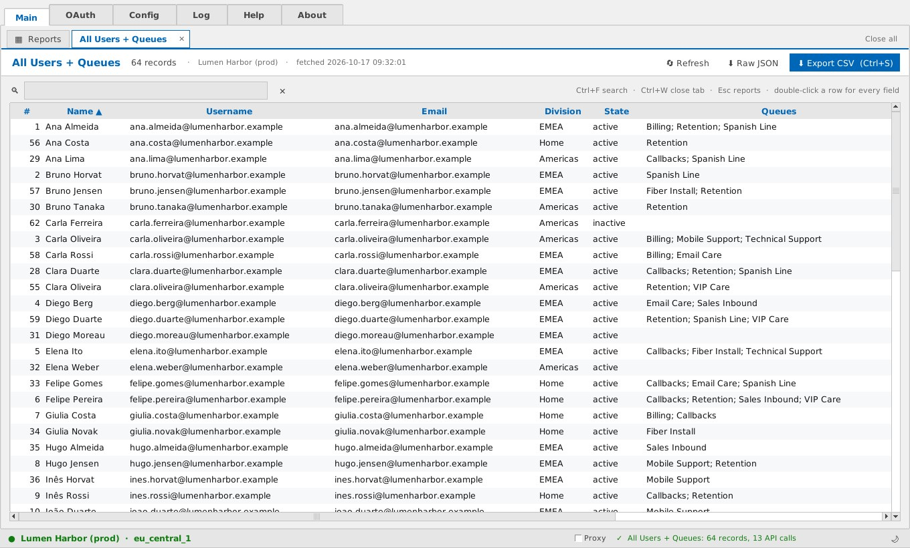
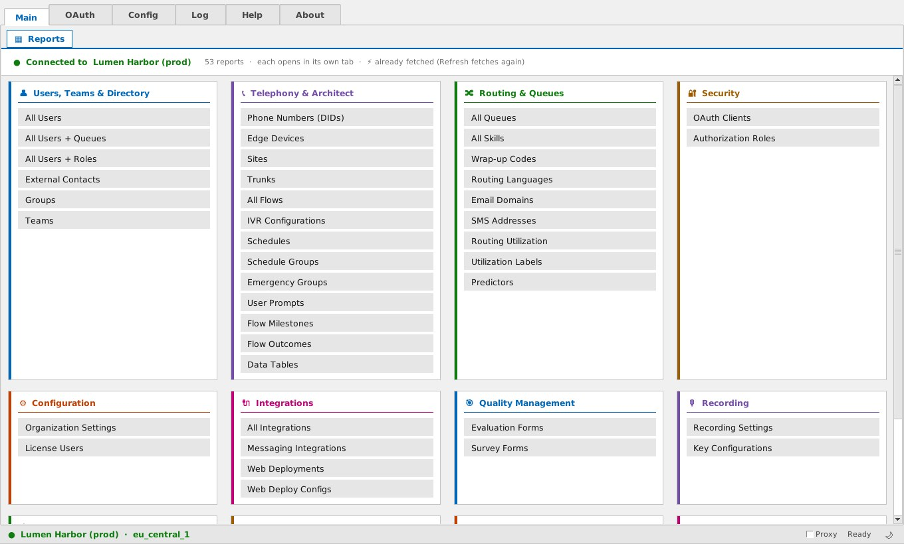
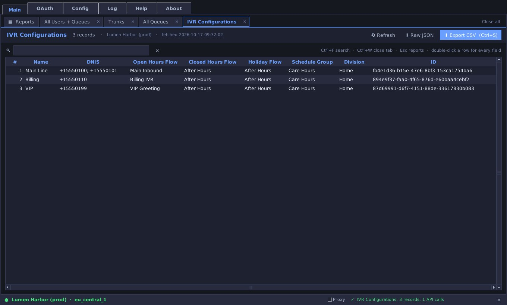
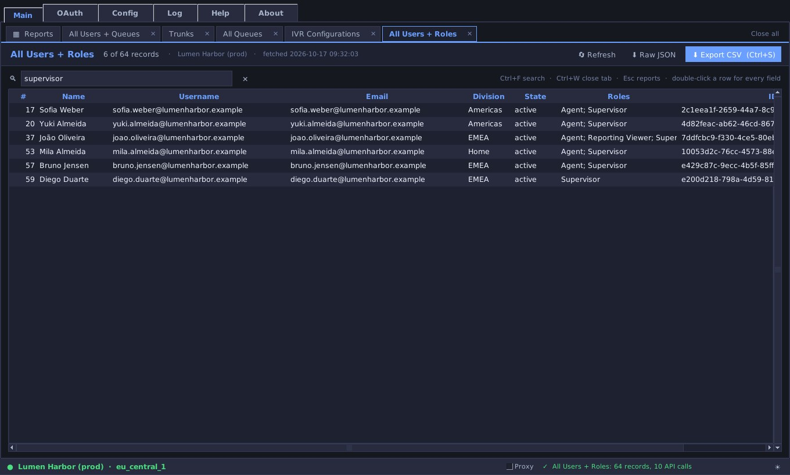
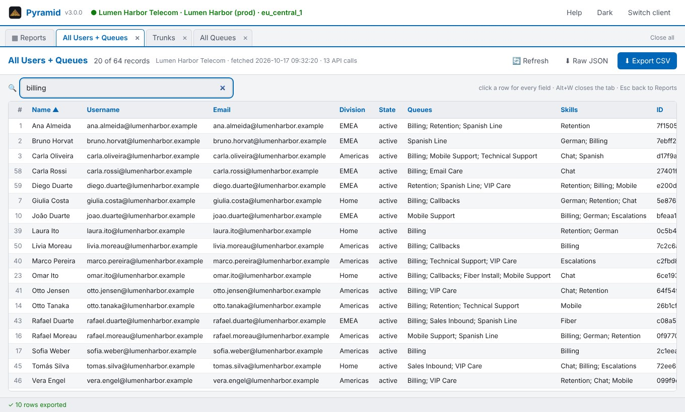
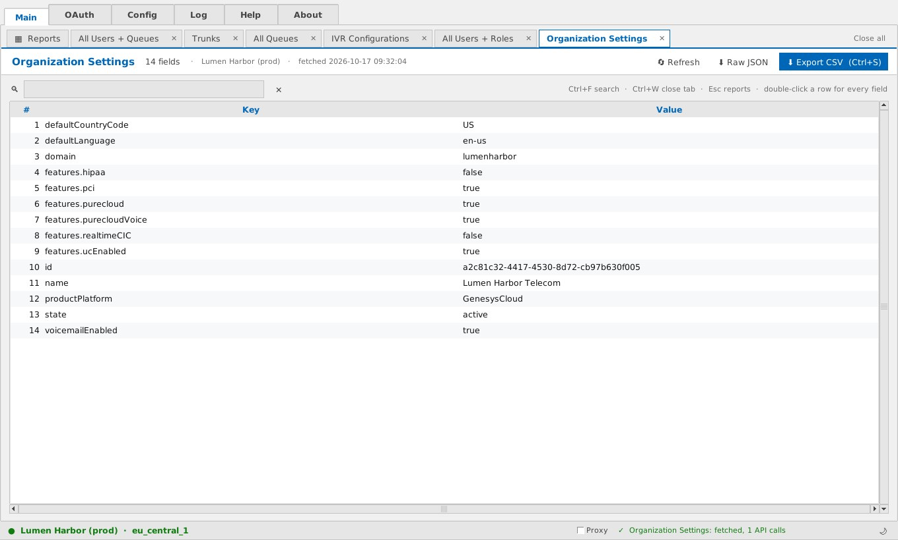
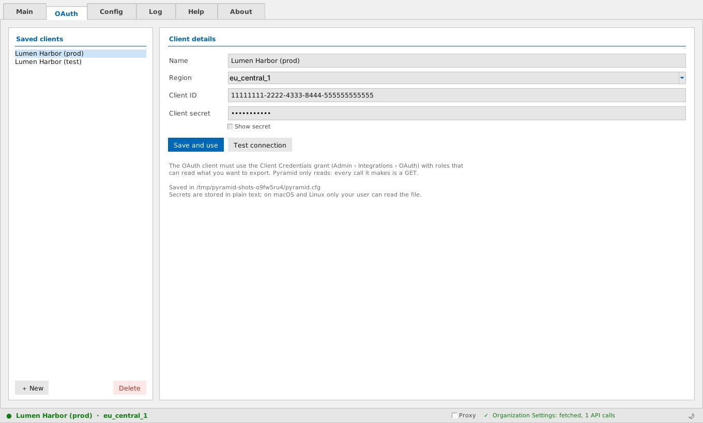
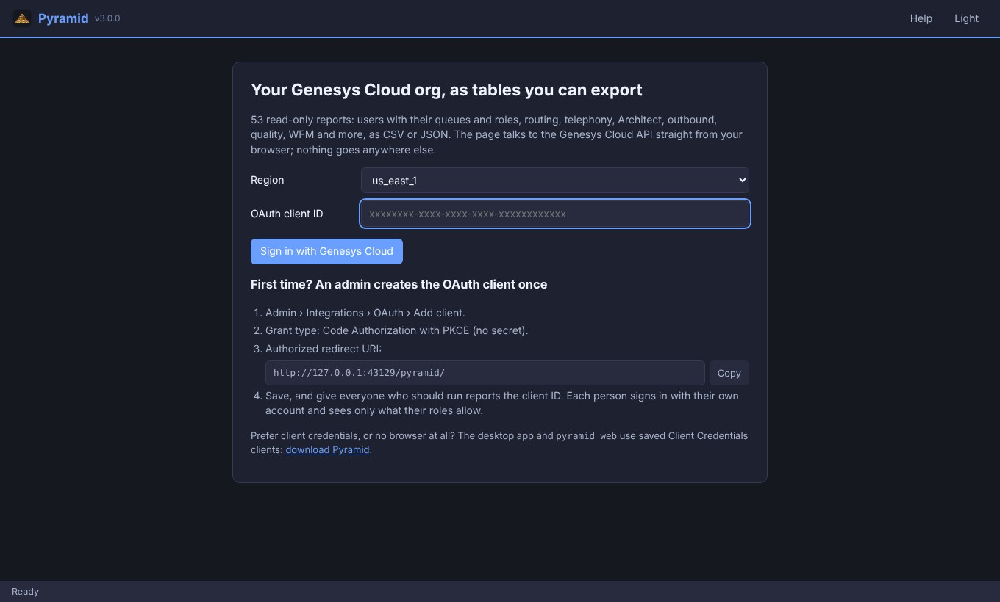
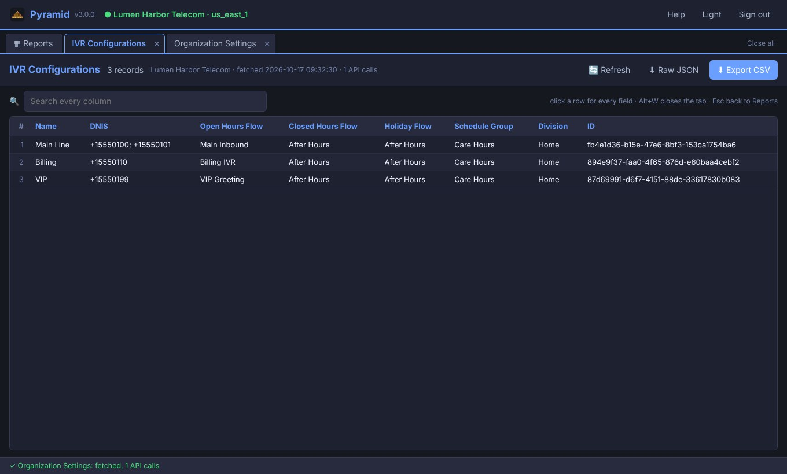

<p align="center">
  
</p>

<h1 align="center">Pyramid</h1>

<p align="center">
  <b>Your Genesys Cloud org, as tables you can search, audit and export.</b><br>
  Users with their queues and roles, routing, telephony, Architect, outbound, quality, WFM and more:<br>
  53 read-only reports, one click each, as CSV or JSON, on Windows, macOS, Linux and in the browser.
</p>

<p align="center">
  
  
  
  
  
</p>

<p align="center">
  <a href="https://github.com/igtoth/pyramid/releases/latest"><b>Download</b></a> &middot;
  <a href="https://igtoth.github.io/pyramid/">Open it in the browser</a> &middot;
  <a href="#why-pyramid">Why Pyramid</a> &middot;
  <a href="CONTRIBUTING.md">Contribute</a>
</p>

<p align="center">
  <sub>An independent open-source tool: not a Genesys product, not affiliated with or endorsed by Genesys. It only reads, and only what the roles of your OAuth client allow.</sub>
</p>

<br>

<p align="center">
  
  <br>
  <sub>All Users + Queues: one row per user with every queue and skill.</sub>
</p>

<p align="center">
  <a href="#why-pyramid">Why Pyramid</a> &middot;
  <a href="#features">Features</a> &middot;
  <a href="#every-report">Every report</a> &middot;
  <a href="#the-web-version">Web version</a> &middot;
  <a href="#made-to-be-automated">Automation</a> &middot;
  <a href="#security-and-privacy">Security</a> &middot;
  <a href="#downloads">Downloads</a>
</p>

<br>

<table>
  <tr>
    <td width="25%" valign="top">
      <h3>One click per report</h3>
      53 reports in 12 sections. Each opens in its own tab, with search, sorting and export, and stays in memory until you refresh it.
    </td>
    <td width="25%" valign="top">
      <h3>Joined views of the org</h3>
      Users with all their queues, users with all their roles, metrics of every performance profile: answers the API spreads over thousands of calls, in one table.
    </td>
    <td width="25%" valign="top">
      <h3>Desktop, browser, terminal</h3>
      A native window for Windows, macOS and Linux, the same reports in the browser with your Genesys login, and a command line for scheduled snapshots.
    </td>
    <td width="25%" valign="top">
      <h3>Read only, by design</h3>
      Every call is a GET. Secrets never reach a page or an export. Rate limits are waited out, not hammered.
    </td>
  </tr>
</table>

<br>

## Why Pyramid

Pyramid is for configuration data that is hard to get out of Genesys Cloud
as one table. As of October 2026, most admin pages show one object at a time,
and the People page imports users from a CSV but has no matching export.
Community questions such as *"which queues is every agent in?"* or *"who holds
which role?"* are usually answered with the Platform API, the Genesys Cloud CLI
or a custom script. Pyramid turns those API calls into one-click reports.

| What you need | Genesys Cloud admin pages | `gc` CLI | CX as Code (Terraform export) | **Pyramid** |
|---|---|---|---|---|
| Every user, active and inactive, in a spreadsheet | not built in | JSON, convert it yourself | HCL / JSON resources | **one click, CSV** |
| Users with all their queues and skills | not built in | one call per user, plus a script | spread over user and queue resources | **one table** |
| Users with all their roles (access review) | not built in | one call per user, plus a script | separate role resources | **one table** |
| IVRs, schedules, trunks, flows, OAuth clients, campaigns... as tables | page by page | JSON per object type | HCL, meant for re-applying | **53 reports, CSV or JSON** |
| No code, no Terraform | yes | no | no | **yes** |
| Several orgs side by side | one org per login | profiles | one config per org | **saved clients, switch in a click** |
| Nothing to install | yes | no | no | **yes: the web version** |
| Scheduled snapshots of the whole org | not built in | scripts | yes | **`pyramid export all`** |

When to use something else: CX as Code is the tool to **re-create or
migrate** configuration (Pyramid never writes), and the analytics views export
**performance** data (Pyramid exports configuration). Pyramid is for
reading an org quickly: audits, documentation before a change, comparing
before and after a migration, onboarding to an org you do not know yet.

<sub>Based on public Genesys documentation and community posts as of October 2026. Genesys Cloud changes often; corrections are welcome (open an issue).
Sources:
<a href="https://help.genesys.cloud/articles/add-people-csv-file-import/">Bulk upload of people data</a> (import only) ·
<a href="https://community.genesys.com/viewdocument/user-management-users-people-admin-page-update?CommunityKey=f4bf88cc-0f42-4b62-a248-018993248afa&tab=librarydocuments">People admin page update, 2026</a> ·
<a href="https://community.genesys.com/discussion/export-feature-of-user-and-assigned-roleprivilege-configuration-data">exporting users and roles</a> ·
<a href="https://community.genesys.com/discussion/export-list-of-divisions-agents-by-division-and-queues-assigned-to-each-agent">agents with divisions and queues</a> ·
<a href="https://community.genesys.com/discussion/backing-up-of-system">CX as Code export and backups</a> ·
<a href="https://help.genesys.cloud/articles/export-view-data/">Export view data</a> (performance views).</sub>

## Features

Every picture is Pyramid itself against a made-up org (`tests/fake_genesys.py`),
captured by `scripts/screenshots.py` and `scripts/web_check.py`, which also
open every report as an end-to-end test.

<table>
  <tr>
    <td width="50%" valign="top">
      
      <br>
      <sub>The Reports tab: 53 reports in 12 sections.</sub>
      <h3>Every report a click away</h3>
      Users, teams and directory; telephony and Architect; routing and queues; security; configuration; integrations; quality; recording; outbound; WFM; stations and presence; analytics and gamification. Hover a button for what it reads; ⚡ marks reports already fetched.
    </td>
    <td width="50%" valign="top">
      
      <br>
      <sub>Reports open side by side in tabs, dark theme.</sub>
      <h3>One tab per report</h3>
      Each report opens in its own tab next to Reports, so you can compare queues with IVRs with trunks. Reopening a report switches to its tab; Ctrl+W closes one, middle-click too. Up to 12 stay open.
    </td>
  </tr>
  <tr>
    <td width="50%" valign="top">
      
      <br>
      <sub>All Users + Roles, filtered to supervisors.</sub>
      <h3>Search, sort, export what you see</h3>
      The search box filters every column as you type; a click on a header sorts, numbers as numbers. Export CSV saves exactly what is on screen, filter and order included, as UTF-8 that Excel and Power BI open as is. Raw JSON saves the API's own answer.
    </td>
    <td width="50%" valign="top">
      
      <br>
      <sub>The same reports in the browser.</sub>
      <h3>In the browser too</h3>
      <a href="https://igtoth.github.io/pyramid/">igtoth.github.io/pyramid</a> signs you in with your Genesys Cloud account (OAuth PKCE, no secret) and talks to the API straight from your browser. Or run <code>pyramid web</code> to use Client Credentials clients (with secret) in the same page.
    </td>
  </tr>
  <tr>
    <td width="50%" valign="top">
      
      <br>
      <sub>Organization settings as key and value pairs.</sub>
      <h3>Objects as well as lists</h3>
      Organization settings, routing utilization and recording settings come out as searchable key and value pairs, nested objects flattened (<code>features.pci</code>), and export the same way. Double-click any row of any report for every field the API returned.
    </td>
    <td width="50%" valign="top">
      
      <br>
      <sub>Saved OAuth clients, one per org.</sub>
      <h3>Many orgs, one tool</h3>
      Save a Client Credentials OAuth client per org (all 18 Genesys Cloud regions), switch with a click, test the connection. Results are kept per org, so switching never mixes them up.
    </td>
  </tr>
</table>

## Every report

<table>
  <tr>
    <td width="33%" valign="top">
      <h4>👤 Users, teams and directory</h4>
      All Users (active and inactive, last token and last login) · All Users + Queues · All Users + Roles · External Contacts · Groups · Teams
      <h4>📞 Telephony and Architect</h4>
      Phone Numbers (DIDs) · Edge Devices · Sites · Trunks · All Flows · IVR Configurations · Schedules · Schedule Groups · Emergency Groups · User Prompts · Flow Milestones · Flow Outcomes · Data Tables
    </td>
    <td width="33%" valign="top">
      <h4>🔀 Routing and queues</h4>
      All Queues (right-click: members) · All Skills · Wrap-up Codes · Routing Languages · Email Domains · SMS Addresses · Routing Utilization · Utilization Labels · Predictors
      <h4>🔐 Security</h4>
      OAuth Clients (never their secrets) · Authorization Roles (with user counts)
      <h4>⚙ Configuration</h4>
      Organization Settings · License Users
      <h4>🔌 Integrations</h4>
      All Integrations · Messaging Integrations · Web Deployments · Web Deploy Configs
    </td>
    <td width="33%" valign="top">
      <h4>🎯 Quality</h4>
      Evaluation Forms · Survey Forms
      <h4>🎙 Recording</h4>
      Recording Settings · Key Configurations (never their API keys)
      <h4>📤 Outbound</h4>
      Campaigns · Contact Lists · DNC Lists · Call Analysis Response Sets · Campaign Sequences
      <h4>📅 Workforce management</h4>
      Business Units · Management Units
      <h4>📱 Stations and presence · 📊 Analytics and gamification</h4>
      Stations · Presence Definitions · Report Exports · Performance Profiles · Gamification Metrics · Metric Definitions
    </td>
  </tr>
</table>

Every report is one entry in [`src/pyramid/catalog.json`](src/pyramid/catalog.json):
the API path, how it pages and which columns to show. Adding one is a few
lines of JSON, and the tests check the path and every column against the
Genesys Cloud API definition.

## The web version

<table>
  <tr>
    <td width="50%" valign="top">
      
    </td>
    <td width="50%" valign="top">
      
    </td>
  </tr>
</table>

**[igtoth.github.io/pyramid](https://igtoth.github.io/pyramid/)**, nothing to install. An admin creates one OAuth client for the org, once:

1. Admin › Integrations › OAuth › Add client.
2. Grant type: **Code Authorization with PKCE** (no secret). Genesys stopped offering the implicit grant for new clients in May 2026; PKCE is its replacement for browser apps.
3. Authorized redirect URI: `https://igtoth.github.io/pyramid/`
4. Hand out the client ID. Everyone signs in with their own account and sees only what their own roles allow.

Same tabs as the desktop app (Main, OAuth, Config, Log, Help, About). Add a
client in the OAuth tab and sign in with your Genesys account (PKCE). A
**Client secret** is not offered on this page: Genesys Cloud does not let a
web page use the Client Credentials grant (its token endpoint sends no CORS
headers for it), so for a secret use the desktop app or `pyramid web` below.
**Nothing is stored on any server:** the page runs in your
browser and talks only to Genesys Cloud; your clients stay in the tab's
session, or in the browser when you tick *Remember*; *Forget everything*
clears it all. Prefer to keep everything in your
network? Serve the same files from your own host (the `web` job in
[`build.yml`](.github/workflows/build.yml) shows the two folders it takes) and
register that URL as the redirect URI.

**`pyramid web`** serves the same page on your computer, with the full OAuth
tab of the desktop app: add, edit, test and delete Client Credentials clients
(name, region, client ID, secret) in the page. They are saved in the same
`pyramid.cfg` as the desktop app; the Pyramid process gets the token and adds
it to each request, and a saved secret is never sent back to the browser. More in [`docs/web.md`](docs/web.md).

## Made to be automated

The desktop download is also a command line, and `pip install` gives you the same:

```sh
pyramid list                                         # the 53 report keys
pyramid export users usersqueues usersroles --client "Prod" -o exports/
pyramid export all --client "Prod" --format both -o snapshot/   # the whole org, CSV + JSON
pyramid web                                          # the web version on this computer

# without a saved client (CI, cron, a container)
export GC_REGION=eu_central_1 GC_CLIENT_ID=... GC_CLIENT_SECRET=...
pyramid export all -o "snapshot-$(date +%F)/"
```

A dated `export all` every night gives you a history of the org's configuration
that any diff tool can compare. The exit code is not zero when a report fails,
so a scheduler notices.

## Under the hood

- **One catalog, three front ends.** The desktop app (Tkinter), the web page
  (plain JavaScript, no framework, no build step) and the command line read the
  same [`catalog.json`](src/pyramid/catalog.json) and apply the same rules;
  a test runs the JavaScript in Node and checks that every report gives the same
  rows and the same CSV bytes as the Python code.
- **The REST API, no SDK.** Pyramid calls `/api/v2` with the standard library
  (plus `certifi`). The official SDK has thousands of generated modules and
  renames methods between versions, which had broken four buttons of v2. The
  fields are still checked against the SDK's own model definitions in the tests
  ([`scripts/sdk_fields.py`](scripts/sdk_fields.py)), so a renamed API field
  fails a test instead of leaving an empty column.
- **Polite with the API.** Paging by page number or cursor (whatever the
  endpoint uses), `Retry-After` honoured on 429, backoff on 5xx, a fresh token
  on 401, and reports that join data (users with queues or roles) read per queue
  or per role instead of per user: 13 calls for 64 users and 10 queues.
- **A window that never freezes.** Every request runs on a worker thread that
  never touches Tk; Cancel stops a request at once, even mid-wait.
- **Tested against a made-up org.** [`tests/fake_genesys.py`](tests/fake_genesys.py)
  serves every endpoint, with paging, 429s, errors and PKCE; CI opens all 53
  reports in the real desktop window (Xvfb) and in Chromium, in both web modes.
- **Native builds.** Nuitka compiles Python to C for each platform (no
  `%TEMP%` unpacking, which is what makes antivirus tools flag many Python
  programs); about 40 MB installed.

## Get started

From source (Python 3.10 or newer; on Linux also `python3-tk`):

```sh
git clone https://github.com/igtoth/pyramid
cd pyramid
pip install -e .
pyramid                      # the desktop app
pytest                       # the tests (fake Genesys Cloud, no credentials needed)
```

The OAuth client for the desktop app and the command line uses the
**Client Credentials** grant (Admin › Integrations › OAuth) with a role that can
read what you want to export. New contributors: [`CONTRIBUTING.md`](CONTRIBUTING.md).

## Downloads

Each version gets a release with downloads for every platform: take the
[latest release](https://github.com/igtoth/pyramid/releases/latest). Every push
to `main` also refreshes the **Nightly build** pre-release.

| Platform | Files |
|---|---|
| Windows (x64) | `pyramid-<version>-windows-x86_64-setup.exe` (installer, no admin rights needed), `pyramid-<version>-windows-x86_64-portable.zip` |
| macOS (Apple silicon, Intel) | `pyramid-<version>-macos-arm64.dmg`, `pyramid-<version>-macos-x86_64.dmg` |
| Linux (x86_64) | `pyramid-<version>-linux-x86_64.AppImage`, `pyramid-<version>-linux-x86_64.tar.gz` |
| Web | no download: [open it in the browser](https://igtoth.github.io/pyramid/) |
| Python | `pip install git+https://github.com/igtoth/pyramid` |

The downloads are not code-signed yet. Windows: if SmartScreen warns, More info › Run anyway.
macOS: right-click › Open the first time. Every release lists the SHA-256 of each file.

## Security and privacy

- **Read only.** Every request is a GET; there is no code path that writes to
  your org. Give the OAuth client a role with view permissions only.
- **Secrets stay put.** Client secrets live in `pyramid.cfg` in your user
  profile (`%APPDATA%\Pyramid`, `~/Library/Application Support/Pyramid`,
  `~/.config/Pyramid`), readable only by you on macOS and Linux. OAuth client
  secrets and recording API keys are removed from every report and every JSON
  export.
- **No telemetry.** Pyramid talks to Genesys Cloud and nothing else. The web
  page has no backend; its Content Security Policy only allows Genesys Cloud
  hosts.
- **`pyramid web` is local.** It listens on 127.0.0.1 only, needs a random
  session key, checks the `Host` header and forwards only GETs to `/api/v2/`.
  Saving a client from the page also needs a same-origin JSON request with a
  custom header, which no other site can send.
- **Safe spreadsheets.** Exported cells that a spreadsheet would run as a
  formula (`=`, `+`, `-`, `@`) get a leading apostrophe.

The full policy is in [`PRIVACY.md`](PRIVACY.md). Reports can contain personal
data (names, e-mail addresses, login dates); handling it is up to you, under the
law that applies to you (GDPR, LGPD, ...).

## Documentation

| Document | What it covers |
|---|---|
| [`docs/CHANGELOG.md`](docs/CHANGELOG.md) | what changed, version by version |
| [`docs/web.md`](docs/web.md) | the web version: PKCE setup, self-hosting, `pyramid web` |
| [`CONTRIBUTING.md`](CONTRIBUTING.md) | the layout of the code, adding a report, tests, builds |
| [`PRIVACY.md`](PRIVACY.md) | what Pyramid stores and sends |
| [`old/README.md`](old/README.md) | 20 years of history: the 2005 T-Server tools, v1 (2021), v2 (2025) |

---

## License and credits

[MIT](LICENSE). Copyright &copy; 2024-2026 Ighor Toth.

Written by **Ighor Toth** ([toth@ighor.com](mailto:toth@ighor.com) ·
[ighor.com](https://ighor.com)) with Claude Code, Anthropic's AI coding
assistant, as co-author: commits it helped write carry a `Co-Authored-By` line.

<sub>Pyramid is an independent open-source project, not affiliated with, sponsored by or endorsed by Genesys. Genesys, Genesys Cloud and PureCloud are trademarks of their owner, used here only to describe what Pyramid works with. Use Pyramid only with organizations you are authorized to access. The software is provided "as is", without warranty of any kind, as the license states.</sub>
